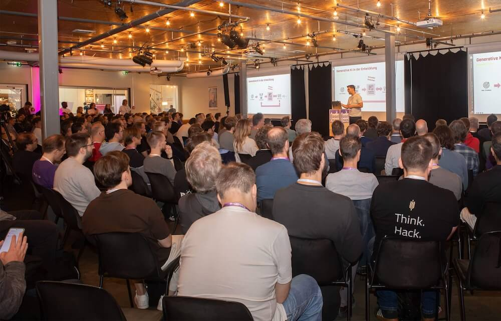
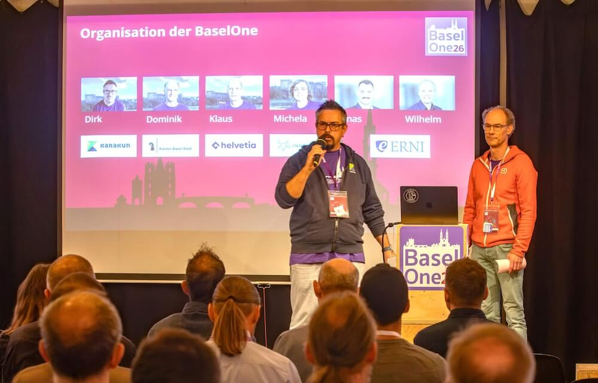
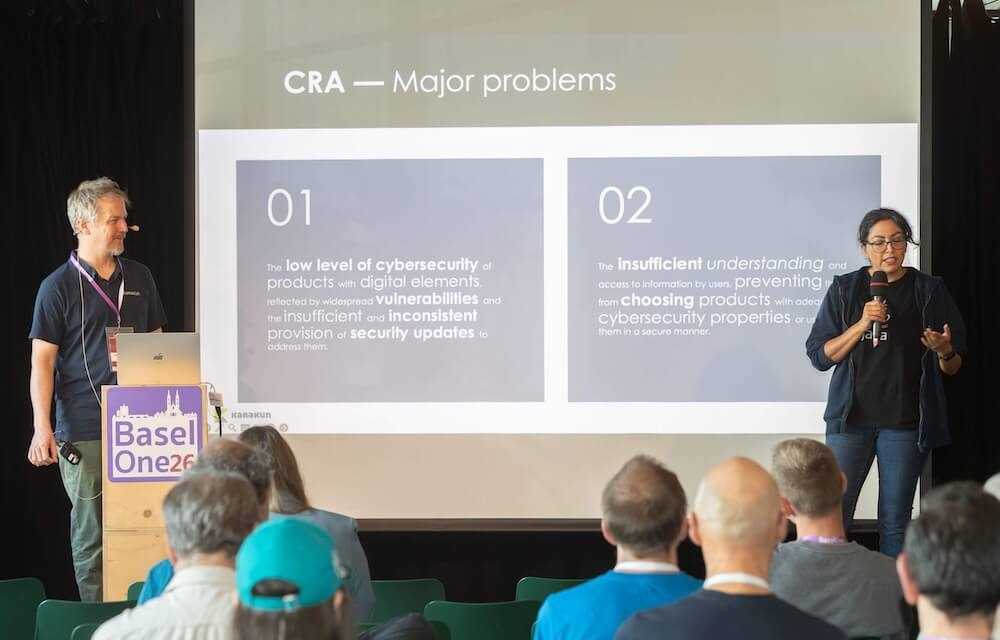
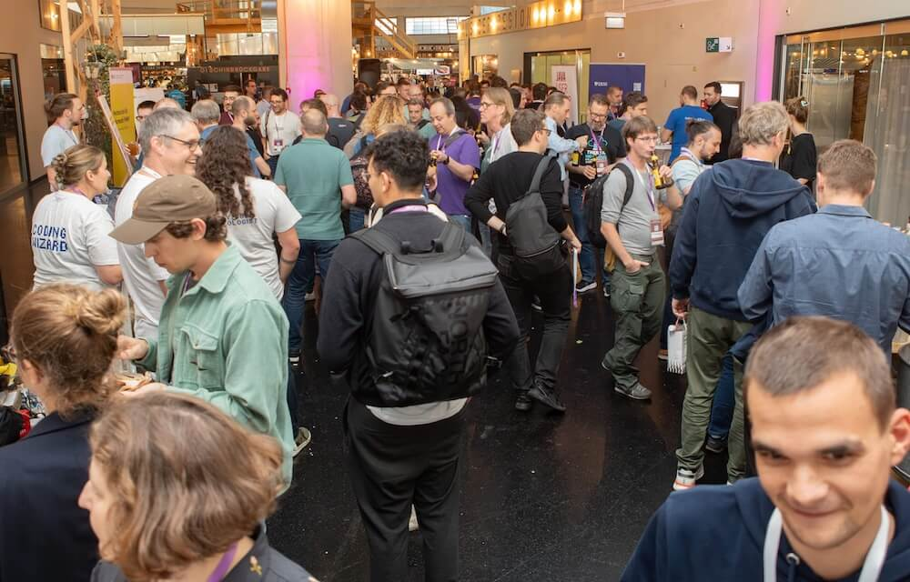

**TL;DR:** Karakun’s contribution to BaselOne 2026 extended from organising the event and leading the programme committee to delivering four technical talks. 
The biggest reward was the response: happy participants, lively conversations, and positive feedback that made months of volunteer work worthwhile. 
In 2027, we’ll celebrate BaselOne’s tenth anniversary with the community.

---

**In this article:**
- [Helping Bring BaselOne 2026 Together](#helping-bring-baselone-2026-together)
- [Four Karakun Talks on Software Quality, Security, and AI](#four-karakun-talks-on-software-quality-security-ai)
	- [Antifragile Software by Design](#antifragile-software-by-design)
	- [CRA security deadlines loom: What senior Java engineers must deliver by December 2027](#cra-security-deadlines)
	- [AI Broke my Test Suite - PUnit Fixed it](#probabilistic-testing-with-punit)
	- [82 Bugs I Collected in a Year You Won't Believe Made It to Production](#lessons-from-82-production-bugs)
- [Keynote: From Vibe Coding to Sustainable AI-Assisted Development](#keynote-vibe-coding-sustainable-ai-assisted-development)
- [Community, Conversations, and the Markthalle](#community-conversations-and-the-markthalle)
- [Looking Ahead: BaselOne’s Tenth Anniversary in 2027](#outlook-baselone-anniversary-2027)
- [Curious about BaselOne?](#cta)

---

BaselOne 2026 brought more than 300 participants to Basel’s Markthalle for workshops on October 14 and conference sessions on October 15, 2026. 
Karakun contributed four talks and helped shape and organise the event. Our colleague [Ixchel Ruiz](/people/ixchel) led the programme committee, while I served on the organising committee.

For us, supporting [BaselOne](https://baselone.org){:target="_blank"} means investing in the developer community in and around Basel.
Sharing knowledge on stage is part of that commitment.
So are the many hours of volunteer work behind the scenes that help make the conference happen.

##  Helping Bring BaselOne 2026 Together

Ixchel led the programme committee, working with fellow members to shape the conference programme. 
I helped organise the event alongside my fellow organising committee members and joined Dominik Berger on stage to welcome participants and open the conference.

For me as an organiser, the final weeks brought some suspense: a large share of tickets sold in the last two weeks before the event. 
That made it especially rewarding to see the turnout, the many happy faces, and the positive feedback from participants.

Those moments reminded me why I put time into organising BaselOne.
A conference takes months of preparation, but seeing people learn, reconnect, and enjoy themselves makes the effort worthwhile.

##  Four Karakun Talks on Software Quality, Security, and AI

On October 15, five Karakun speakers contributed four sessions, exploring different ways to build, test, and maintain reliable software.

###  Iryna Dohndorf: Antifragile Software by Design

In “Unbreakable by Design: The Secret Tech of Antifragile Software,” [Iryna Dohndorf](/people/iryna) explored how software systems can benefit from the faults and failures they encounter.

Her session examined antifragility and resilience through architectural and operational principles, fault tolerance, and approaches to handling errors.
It also connected the resilience of the resulting software with the practices of the teams developing it.

###  Ixchel Ruiz and Markus Schlichting: SBOMs and Software Supply-Chain Security

With “CRA security deadlines loom: What senior Java engineers must deliver by December 2027,” Ixchel Ruiz and [Markus Schlichting](/people/markus) brought software supply-chain transparency into focus.

Their session addressed the practical role of Software Bills of Materials (SBOMs) in the Java ecosystem, including transitive dependencies, build pipelines, and container components.
Tools such as CycloneDX and Dependency-Track connected the topic with everyday development workflows.

For a broader perspective on how regulatory requirements connect with good engineering practices, read Karakun’s article [Regulation as an Opportunity](https://karakun.com/en/regulation-as-an-opportunity/){:target="_blank"}.

###  Mike Mannion: Probabilistic Testing with PUnit

What happens when the same input does not always produce the same output?
In “AI Broke my Test Suite - PUnit Fixed it,” [Mike Mannion](/people/mike) addressed the testing challenges of non-deterministic systems, including AI-powered applications and external services.

Mike introduced [PUnit](/punit), a Java/JUnit-based framework for probabilistic testing.
His session explored how repeated observations, success-rate thresholds, and statistical confidence can help teams assess behaviour that a single deterministic assertion cannot adequately capture.

For more on testing non-deterministic systems, read Mike’s [Reflections on Testing AI and Non-Deterministic Systems](/2026/04/02/Swiss-Testing-Day.html).
His article [The AI Productivity Mirage — and What It’s Missing](/2025/12/12/AI_Mirage.html) explores why engineering experience and judgment remain essential when working with AI.

###  François Martin: Lessons from 82 Production Bugs

[François Martin](/people/francois)’s “82 Bugs I Collected in a Year You Won't Believe Made It to Production” took everyday applications and websites as its starting point.

His collection of real-world bugs illustrated common development mistakes and testing blind spots.
The session focused on what teams can learn from those failures to improve software reliability and prevent similar problems from reaching users.

You can explore more presentations, slides, and recordings in the [Karakun Developer Hub talk collection](/talks).

##  Stefan Toth’s Keynote: From Vibe Coding to Sustainable AI-Assisted Development

Stefan Toth opened the conference programme with “Von Vibe-Coding zum ‘Sustainable Vibe’,” examining how AI-assisted development can become a sustainable part of professional software engineering.

The keynote connected coding tools with broader questions about architecture, requirements, testing, and feedback.
For me, the highlight was Stefan’s delivery: his charisma and ability to explain the subject made it engaging even for listeners without deep technical knowledge of the topic.

Stefan Toth’s keynote is available on [YouTube](https://www.youtube.com/live/ztO6RE6L3Xk){:target="_blank"}.

Sessions held in the Wohnzimmer, the conference’s largest room, were also recorded.
These recordings will soon be available on the [BaselOne YouTube channel](https://www.youtube.com/@baselone9688){:target="_blank"}.

##  Community, Conversations, and the Markthalle

Between sessions, the sponsor area was busy with conversations, and the competitions added to the fun.
Familiar faces and first-time visitors mingled throughout the venue, creating the welcoming atmosphere that stood out to us this year.

The Markthalle’s food deserves a mention, too.
Its variety is a real benefit for hungry conference attendees, even if the acoustics of such a lively venue can occasionally be a challenge.

My personal highlight was seeing people enjoy the event and hearing their encouraging feedback — especially after the preparations and the uncertainty around late ticket sales.

More photos from BaselOne 2026 will soon be available on the BaselOne website.

##  Looking Ahead: BaselOne’s Tenth Anniversary in 2027

In 2027, BaselOne will celebrate its tenth anniversary — a milestone we look forward to sharing with the community.

Thank you to our fellow organisers, programme committee members, speakers, sponsors, volunteers, and everyone who attended BaselOne 2026. 
Your participation and enthusiasm are what make the event worth building together.

##  Curious about BaselOne?
Thinking about attending BaselOne or submitting a talk for the 2027 anniversary edition? [Get in touch with me](/people/dirk). I’m always happy to exchange knowledge, ideas, and experiences.